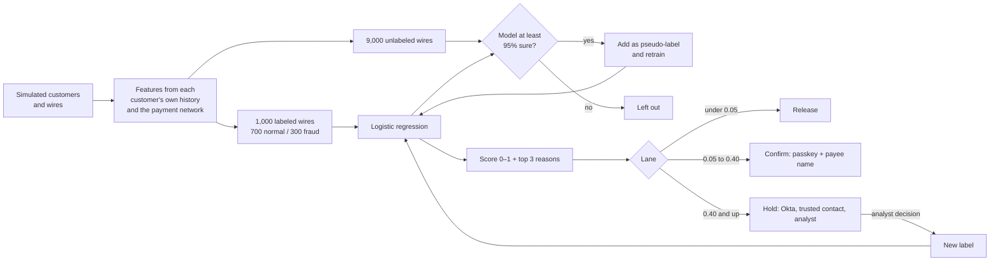

# Meridian wire fraud prototype

A working prototype of AI-driven wire-fraud screening for Meridian Community Bank, built by Deloitte.
It simulates bank customers and their wire transfers, trains a **semi-supervised machine-learning model**
on that data, and runs it inside a split-screen demo: the customer sending a wire on one side, the
fraud team's console on the other.

> All data is synthetic. Nothing here uses real customer information.

## What's in the repo

| Path | What it does |
|---|---|
| `sim/simulate.py` | Simulates 1,500 customers, their payees, and ~37,000 wires over 180 days, including four fraud patterns. |
| `ml/features.py` | The 13 model features and how they're transformed. Shared by training, the API, and the browser. |
| `ml/train.py` | Trains the model with scikit-learn self-training, compares it with the alternatives, and saves the model. |
| `ml/scoring.py` | Scores a wire: risk 0–1, top 3 reasons, lane (release / confirm / hold), next steps, voice policy. |
| `api/main.py` | FastAPI service: score wires, save analyst decisions as labels, retrain. No data-export endpoints. |
| `frontend/` | The split-screen demo (`index.html`), the browser engine (`engine.js`), and trained weights (`model_weights.js`). |
| `tests/` | End-to-end tests: simulation, training quality, scoring, the API, and browser/Python parity. |
| `.github/workflows/` | GitHub Actions: retrain and test on every push; publish the demo to GitHub Pages. |

## How the machine learning works



**Data simulation.** Each wire's features are computed the way a bank would compute them:

- **From the customer's own history:** how the amount compares with their usual wires, whether it's outside their usual hours, whether the device is new to them, and whether they've paid this payee before.
- **From the payment network:** how many different customers have paid the receiving account in the last 30 days, which is how mule accounts show up.
- **From outside sources:** SIM swaps and the consortium mule list.

Fraud is injected as four patterns: account takeover, business email compromise, deepfake-coached impersonation scams, and synthetic-identity mules. The simulation also includes hard cases on both sides: legitimate first-time payments to brand-new vendors, and fraud sent to older "seasoned" mule accounts.

**Semi-supervised training.** Confirmed fraud labels are scarce, so the model uses scikit-learn's `SelfTrainingClassifier` around a logistic regression:

1. It learns from 1,000 labeled wires.
2. It labels the unlabeled wires it is at least 95% sure about, then retrains on them.
3. It repeats until no new wires reach 95%.

Logistic regression was chosen because every score can be explained: the top 3 reasons are the features that pushed the score up the most. The model is also corrected for the 30% fraud mix in the training labels, so scores reflect a realistic ~3% fraud rate.

**Honest testing.** The test set is the **most recent 3,000 wires**, which the model never sees. This mimics training on the past and predicting the future.

## Results (synthetic data, from `artifacts/metrics.json`)

| On 3,000 held-out wires (82 fraud) | Semi-supervised model | Supervised only | Static rules |
|---|---|---|---|
| Fraud stopped or challenged | **99%** | 91% | 79% |
| Legitimate customers challenged | **11%** | 7% | 31% |
| Fraud sent to Hold | **89%** | 68% | – |
| Flags that turned out legitimate | 80% | 73% | 93% |
| AUC | 0.983 | 0.983 | – |

Self-training pseudo-labeled 7,781 of the 9,000 unlabeled wires, and 99 of those (1.3%) were wrong. The other 1,219 never reached 95% confidence and were left out. The static rules flag any wire over 2.5× usual, to a new payee, or to a high-risk destination.

These numbers show the approach works on data shaped like the problem. They are **not** a forecast for Meridian; that needs a back-test on Meridian's own labeled wire history.

## Run it locally

Requires Python 3.10+ (and Node.js only if you want to run the browser-parity test).

```bash
git clone https://github.com/<you>/meridian-wire-fraud.git
cd meridian-wire-fraud
python -m venv .venv && source .venv/bin/activate      # Windows: .venv\Scripts\activate
pip install -r requirements.txt

python -m ml.train --regenerate     # simulate data + train (about 15 seconds)
pytest -q                           # 9 tests
```

**Option 1: demo only, model in the browser.**
```bash
cd frontend && python -m http.server 5500
# open http://localhost:5500
```

**Option 2: demo + live API (scoring, analyst labels, retraining).**
```bash
uvicorn api.main:app --reload                     # terminal 1, API docs at http://localhost:8000/docs
cd frontend && python -m http.server 5500         # terminal 2
# open http://localhost:5500/?api=http://localhost:8000
```

In API mode, each analyst Release or Block in the employee view is saved to `data/feedback.csv` as a new label. **Retrain with analyst labels** then trains a new model version that includes them.

Demo employee sign-in: **MCB-2041 / meridian-demo**. This is simulated in the browser and is not real security.

## Put it on GitHub

1. Create an empty repository on GitHub named `meridian-wire-fraud`.
2. Push this folder:
   ```bash
   git init && git add . && git commit -m "Wire fraud prototype"
   git branch -M main
   git remote add origin https://github.com/<you>/meridian-wire-fraud.git
   git push -u origin main
   ```
3. In the repository, go to **Settings → Pages → Build and deployment → Source** and choose **GitHub Actions**.
4. Open the **Actions** tab. Two workflows run:
   - **Train and test** simulates data, trains the model, and runs all tests on every push.
   - **Deploy demo to GitHub Pages** retrains and publishes the demo to `https://<you>.github.io/meridian-wire-fraud/`.

The published demo scores wires in the browser with the weights trained in that run. GitHub Pages can't host the Python API; to show retraining live, run the API locally (Option 2) or deploy `api/` to a host such as Azure App Service or Render.

## Using the API

```bash
curl -X POST http://localhost:8000/score -H "Content-Type: application/json" -d '{
  "wire": {"amount": 85000, "usualAmount": 9000, "remoteAccess": true,
           "beneficiaryAgeDays": 12, "firstTimePayee": true, "channel": "online"}
}'
```

The response includes `score`, `lane`, `reasons`, `steps`, `policy` and `modelVersion`. Fields you leave out count as low-risk. The full list of fields is in `ml/scoring.py`.

| Endpoint | Purpose |
|---|---|
| `GET /health` | Status and model version |
| `GET /model` | Version, thresholds, and test results (aggregates only) |
| `POST /score` | Score one wire; writes an audit entry with no names, accounts or amounts |
| `POST /feedback` | Save an analyst decision (`fraud` or `legitimate`) as a label |
| `POST /retrain` | Retrain with all analyst labels and hot-reload the model |

Set `API_KEY` to require an `X-API-Key` header on `/feedback` and `/retrain`. Set `ALLOWED_ORIGINS` to restrict which sites can call the API.

## Built-in controls

- **Voice requests always go to Confirm.** Confirmation then uses a passkey on the verified device and an in-app payee check, never the voice. The result records where the score alone would have routed the wire.
- **No data export.** The API has no endpoint that returns wires, customers, or files. In the employee view, copy, right-click, drag and print are blocked, and printing signs the employee out. Generated data stays out of git (`.gitignore`), and CI keeps only model metrics and weights.
- **Humans decide every hold.** The model never blocks a wire on its own.
- **Every decision is explained and logged.** Each score comes with its model version and top 3 reasons in `artifacts/audit_log.jsonl`.
- **Thresholds are versioned with the model** in `model_weights.json`, so changing them is a reviewed code change.

## Before any real use

This is a prototype. Before production it would need:

- Real authentication: Okta single sign-on and role-based access on the API, replacing the browser-only sign-in.
- Training and back-testing on Meridian's own data, with model-risk review (for example SR 11-7).
- Monitoring for drift, plus champion/challenger runs before a retrained model replaces the current one.
- Encryption and retention controls for feedback and audit logs.
